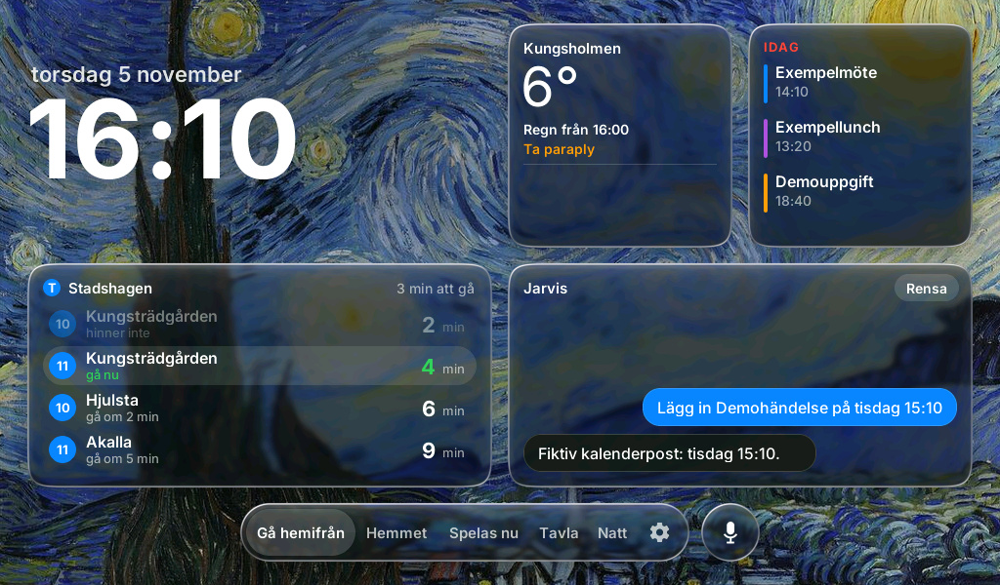
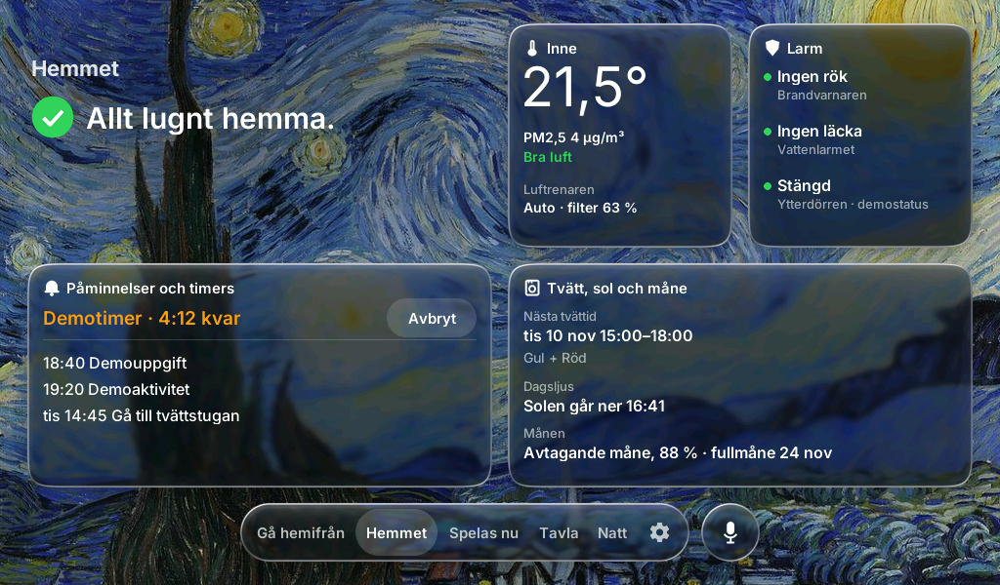
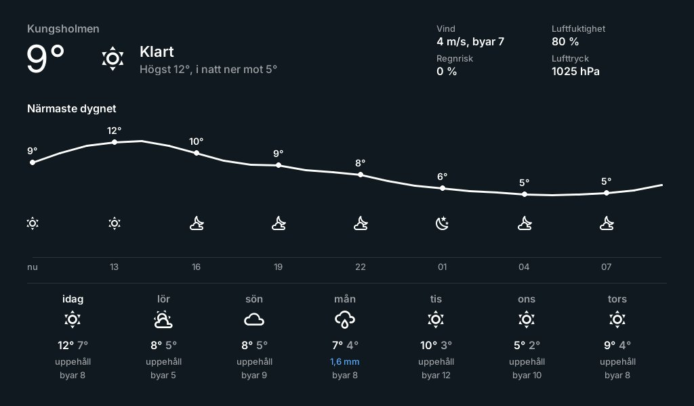
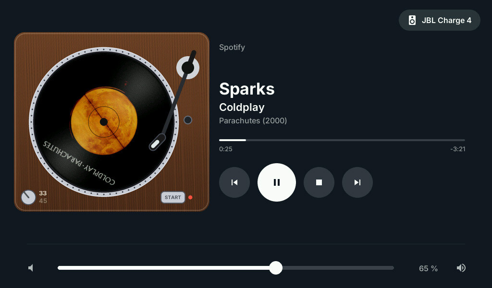
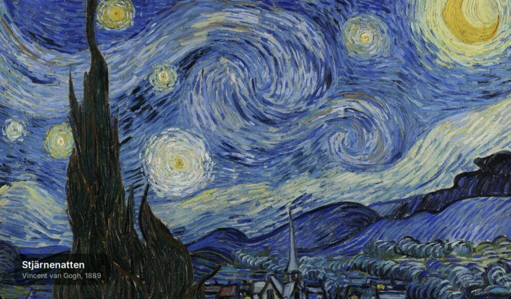
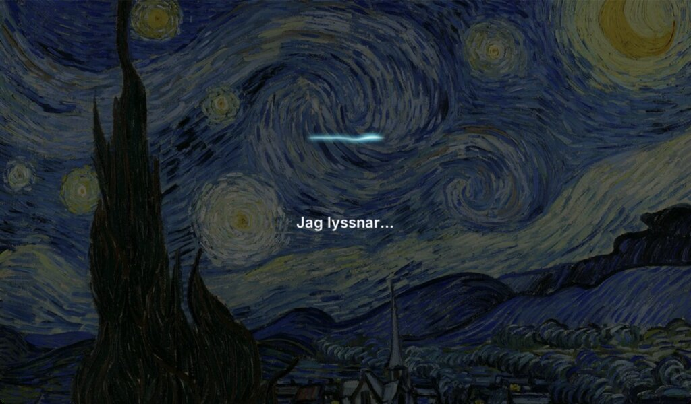
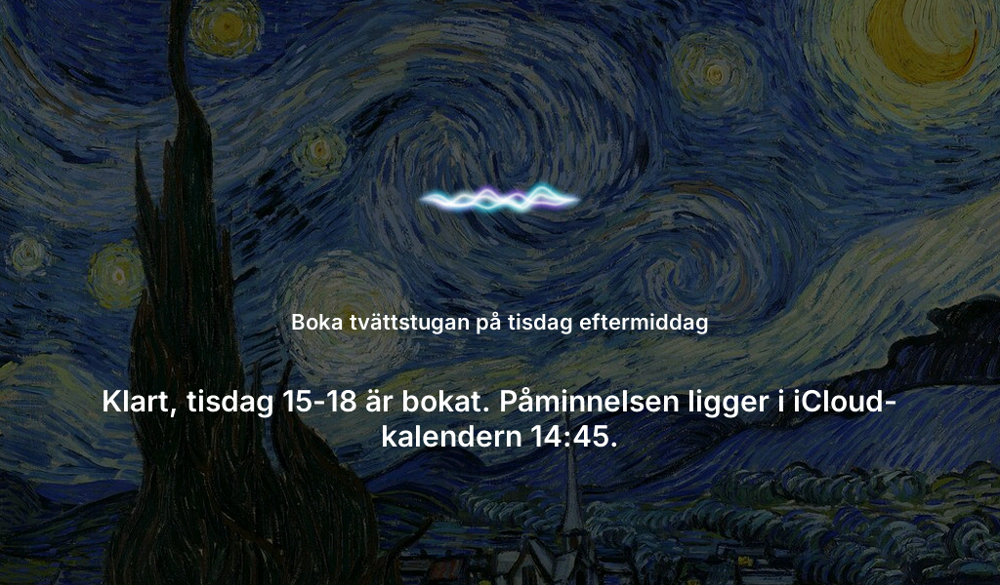
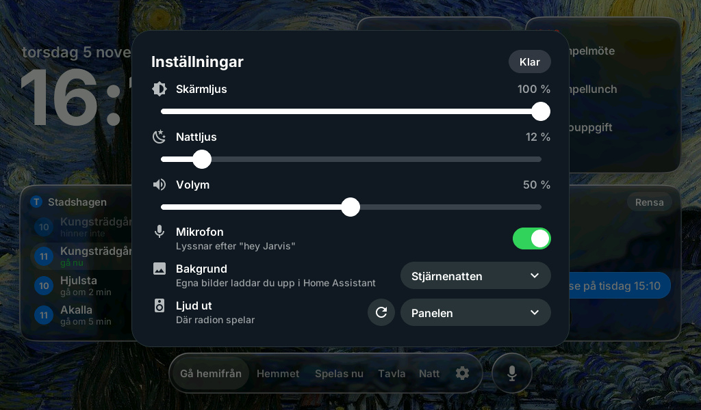
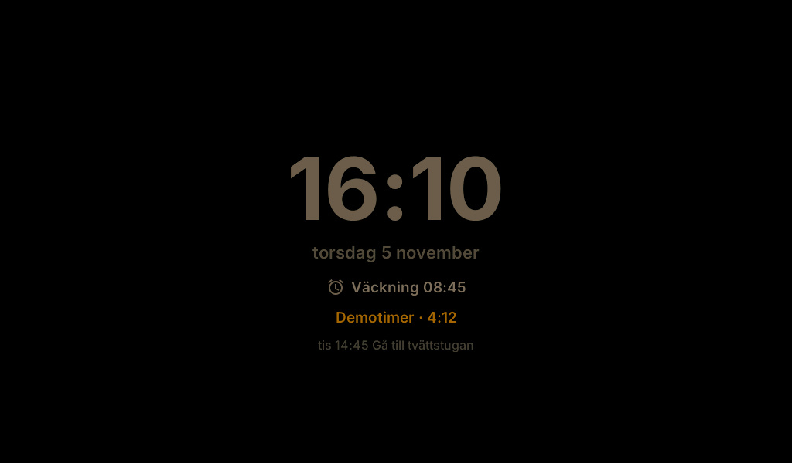

# Jarvis Panel

A 7" touch panel in my bookshelf with its own voice assistant. It was planned for the hallway, so the code still calls it `hallpanel`. An ESP32-P4 runs ESPHome with LVGL, Home Assistant on Jarvis (a Raspberry Pi 5) feeds it data, and "Hey Jarvis" talks to a Claude/OpenAI agent on the same Pi.

This repository holds snapshots of a private working repository, so its history is one "Sync" commit per export; commit messages contain no private change history.



Weather and Now playing are screenshots from the physical panel (2026-10-30 and 2026-11-03), taken over Wi-Fi with `tools/panel`. The other views use ESPHome's SDL simulator; calendar, chat, reminder and wakeup values are fictional with demo data and the built-in Stjärnenatten background, so no real calendar or NASA photographer's picture shows.

## What it shows

| **Home** (*Hemmet*) | **Weather** (*Väder*) |
| --- | --- |
|  |  |
| **Now playing** (*Spelas nu*) | **Picture** (*Tavla*) |
|  |  |
| **Jarvis listening** (*Jag lyssnar…*) | **Jarvis answering** |
|  |  |
| **Settings** (*Inställningar*) | **Night** (*Natt*) |
|  |  |

- **Leaving home** (*Gå hemifrån*), the dashboard – clock, music, weather (tap for the weather page), today's calendar (tap for the week), SL departures with "gå nu" (leave now), and the latest Jarvis exchange.
- **Home** (*Hemmet*) – a green check or the problem, indoor temperature and PM2.5, smoke/leak/door, reminders and timers, the laundry slot, sun and moon. Smoke or a leak opens it at full brightness.
- **Now playing** (*Spelas nu*) – Spotify on the JBL through Jarvis, as a record on a turntable ([spotify](docs/spotify.md), [now playing](docs/now-playing.md)).
- **Picture** (*Tavla*) – the day's picture without glass. The plaque opens NASA's explanation; **Earth** (*Jorden*) shows the whole Earth and today's asteroids ([nasa-refresh](docs/nasa-refresh.md)).
- **Night** (*Natt*) – a black page with a dim clock, between the night times set on the panel.
- **Voice** – "Hey Jarvis" from any page; replies with details show as cards.

## What Jarvis says

These fictional examples illustrate the tools. Calendar entries, bookings and
conversation text in this public snapshot are demonstration data.

- **You:** Boka tvättstugan på tisdag 15-18 och påminn mig 14:45.
  **Jarvis:** Klart, tisdag 15-18 är bokat. Påminnelsen ligger i kalendern 14:45.
- **You:** Lägg till en påminnelse att vattna demoblomman.
  **Jarvis:** Vilken dag och tid vill du ha påminnelsen?

## How it fits together

```
ESP32-P4 panel (ESPHome + LVGL)  ⇄  Home Assistant on Jarvis  ⇄  hallpanel server on Jarvis
  touch, wake word, speaker           pipeline "Jarvis", sensors      agent, voice, reminders, watch
```

- **Hardware:** [Waveshare ESP32-P4-WIFI6-Touch-LCD-7B](https://www.waveshare.com/wiki/ESP32-P4-WIFI6-Touch-LCD-7B). 7" IPS 1024×600, GT911 touch, ESP32-C6 for Wi-Fi 6, 32 MB PSRAM, two mics and a speaker, 5 V over USB-C. Buy the **7B**; the other 7" P4 board is 720×1280.
- **Panel firmware:** generated by `styles/glass-v2/jarvis_orb.py` and turned into a board config by `board.py`.
- **Jarvis side:** `server/` (agent and voice) and `ha/` (the Home Assistant integration). See [docs/jarvis.md](docs/jarvis.md).

## Everyday commands

```sh
tools/sim.sh                         # glass-v2 in the SDL simulator on the Mac (--page hemmet|natt|tavla …)
.venv/bin/python tools/check.py      # free local tests + ESPHome config validation
sh tools/flash_panel.sh              # check, build, upload, then run the release gates
sh tools/deploy_jarvis.sh            # check and install the Jarvis side
tools/panel inspect                  # screenshot + widget tree + status of the real panel
tools/brain.sh                       # which brain Jarvis uses; switch with an argument
uv run tools/voice_loop.py           # talk to Jarvis from the Mac
```

Simulator setup: SDL2 (`brew install sdl2`), the Xcode command line tools, `uv` and ImageMagick 7, then `uv venv --python 3.13 .venv && VIRTUAL_ENV=.venv uv pip install esphome`.

## Layout

| Path | What it is |
| --- | --- |
| `styles/glass-v2/` | The design on the board: page generators, `bake.py` for the glass, the weather page |
| `board.py` | Turns a simulator config into the board's config, through the sections in `board_config/` (hardware, voice, pages, bench, status) |
| `orbs/` | The voice orb (`line_orb.py`, the Jarvis line since 2026-10-28) and the glass orb it replaced |
| `server/` | The Jarvis-side server: agent brains, voice, reminders, notices, lookups |
| `ha/` | The Home Assistant integration `jarvis_agent` and the Hallpanel dashboard |
| `tools/` | Simulator, flash, deploy, `panel` (remote screen and touch) and measurement tools |
| `tests/` | Free checks (`test_*.py`) and the paid model evals (`integration_test.py`) |
| `docs/` | Runbooks and measured reports |
| `sketch/` | Design mock-ups for the weather page and Now playing |

## Docs

- [Physical screen and touch](docs/remote-panel.md) and [visual regression](docs/visual-regression.md)
- [Responsiveness](docs/responsiveness.md), [reliability](docs/reliability.md) and [baselines](docs/baseline/README.md)
- [Release checks and evals](docs/evals.md), [voice latency](docs/voice-latency.md), [wakeups](docs/wakeups.md)
- [Harness maintenance](docs/harness-maintenance.md) – who owns which check

## Artwork credits

- *The Starry Night* (1889), *Almond Blossom* (1890) and *Self-Portrait* (1889) by Vincent van Gogh. Public domain, Google Art Project scans via Wikimedia Commons.
- *"Cosmic Cliffs" in the Carina Nebula* (2022), NASA, ESA, CSA and STScI. Public domain, via Wikimedia Commons.
- The daily picture: NASA Astronomy Picture of the Day, credited on Tavla's plaque.
